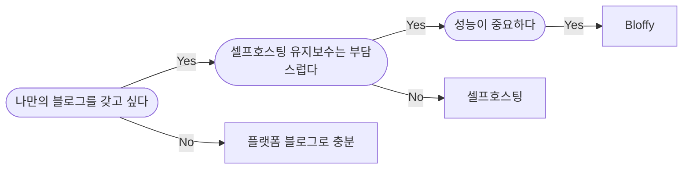

> [!info] 원문
> [Show HN: I built a Markdown and raw HTML blog platform scoring 99 on PageSpeed](https://bloffy.co/en) · Hacker News (Top)

## 핵심 개념

> [!abstract]
> Bloffy는 독자 페이지에 3.2KB 스크립트만 추가하며 Markdown/HTML/CSS/JS로 자유롭게 글을 쓸 수 있는 1인 개발 블로그 플랫폼입니다. PageSpeed Insights 전 카테고리(Performance, Accessibility, Best Practices, SEO) 100점을 목표로 이미지 최적화, 엣지 캐시, 접근성 명암비까지 신경 쓴 설계가 특징입니다. 쿠키 없는 자체 애널리틱스, 다국어 번역 관리, 워크스페이스 기반 팀 운영, 커스텀 도메인과 코드 인젝션 등 실무에 필요한 기능도 함께 제공합니다.

## 아티클

# 마크다운으로 자유롭게 쓰고, PageSpeed 100점을 받는 블로그 플랫폼 Bloffy

블로그를 운영하다 보면 늘 두 가지 선택지 사이에서 고민하게 됩니다. 워드프레스 같은 플랫폼을 쓰자니 성능과 자유도가 아쉽고, 직접 호스팅하자니 유지보수 부담이 만만치 않죠. Hacker News에 올라온 Bloffy는 이 딜레마를 정면으로 겨냥한 1인 개발 프로젝트입니다. 독자 페이지에 추가되는 건 단 3.2KB짜리 스크립트 하나뿐이고, 광고 여부·분석 도구·도메인까지 모두 작성자가 직접 결정할 수 있는 구조로 설계됐습니다. 개발자가 2년 넘게 혼자 기획하고 만든 서비스라는 점도 눈에 띕니다.

## 왜 마크다운과 HTML인가

Bloffy가 내세우는 첫 번째 철학은 "일반 텍스트는 의미를 담지 못하고, 블록 에디터는 의미를 표현하기 어렵게 만든다"는 문제의식입니다. 노션류의 블록 에디터는 UI는 편하지만, 글의 구조적 의미(semantics)를 정확히 표현하기엔 제약이 많다는 거죠. 그래서 Bloffy는 Markdown, HTML, CSS, JavaScript를 그대로 쓸 수 있게 해서, 작성자가 의도한 의미를 정확히 표현할 수 있도록 했습니다.

에디터는 왼쪽에 소스, 오른쪽에 미리보기가 나란히 뜨는 split-view 구조입니다. H1~H4 헤딩, 볼드/이탤릭/취소선 같은 기본 서식은 물론, `<style>` 태그를 직접 넣어 커스텀 CSS 클래스까지 적용할 수 있습니다. 예시로 제시된 코드를 보면:

```html
<style>
.highlight {
  background-image: linear-gradient(90deg, rgba(91,46,229,0.7), rgba(139,107,255,0.4));
  color: white;
}
</style>
```

이렇게 작성한 글 안에 직접 그라데이션 하이라이트 스타일을 넣을 수 있고, Mermaid 다이어그램 같은 것도 코드 블록으로 바로 렌더링됩니다.

## 성능에 대한 집착: PageSpeed 100점을 목표로

Bloffy가 가장 강조하는 지점은 역시 성능입니다. [PageSpeed Insights(PSI)](https://developers.google.com/speed/docs/insights/v5/about) 기준으로 Performance, Accessibility, Best Practices, SEO 네 가지 카테고리 모두에서 100점을 목표로 설계됐다고 밝히고 있습니다. 다만 블로그마다 콘텐츠 구성이 다르기 때문에 점수는 약간씩 달라질 수 있다는 단서도 달아놨습니다.

실제 예시로 제시된 Web Vitals 지표는 다음과 같습니다.

- FCP(First Contentful Paint): 0.8s
- LCP(Largest Contentful Paint): 1.7s
- TBT(Total Blocking Time): 0ms
- CLS(Cumulative Layout Shift): 0

이 정도면 "Good" 등급을 받기에 충분한 수치입니다. 이런 성능은 몇 가지 구체적인 장치 덕분에 가능해 보입니다.

- **이미지 최적화**: 본문 이미지는 384w, 640w, 828w, 1200w 등 폭별 후보 이미지와 함께 webp, avif 같은 최신 포맷으로 자동 제공됩니다.
- **엣지 캐시**: 발행된 페이지는 전 세계 엣지 네트워크에서 서빙됩니다.
- **최소한의 스크립트**: 독자 페이지에 추가되는 스크립트가 3.2KB에 불과해 렌더링 차단 요소를 최소화합니다.

## Bloffy가 맞는지 판단하는 세 가지 질문

랜딩 페이지에는 Bloffy가 자신에게 맞는 선택인지 판단할 수 있는 간단한 플로우차트가 제시됩니다.



세 질문 모두에 "예"라고 답한다면, 즉 자기 소유의 블로그를 원하면서 셀프호스팅의 번거로움은 피하고 싶고, 동시에 성능까지 신경 쓰는 사람이라면 Bloffy를 시도해볼 만하다는 포지셔닝입니다.

## 커스터마이징: 테마와 CSS

디자인 면에서는 매거진 커버, 문예지, 뉴스레터, 포토 모자이크 등 다양한 스타일의 테마를 제공해 원하는 블로그 느낌을 고를 수 있습니다. 미리 만들어진 테마가 마음에 들지 않으면 CSS를 직접 수정해 브랜드에 맞게 다듬을 수도 있습니다. 버튼이나 드롭다운 UI만으로는 세밀한 제어가 어렵다는 점을 지적하며, CSS 변수 기반의 정밀한 커스터마이징을 지원합니다.

실제로 공개된 커스텀 CSS 예시를 보면 라이트/다크 테마를 CSS 커스텀 프로퍼티로 체계적으로 관리하고 있는데, 특히 눈에 띄는 부분은 명암비(contrast ratio) 수치를 주석으로 직접 명시해뒀다는 점입니다.

```css
--color-ink: #1a1922; /* 16.2:1 */
--color-ink-muted: #55525f; /* 7.1:1 */
--color-link: #5b2ee5; /* 6.6:1 */
```

다크 테마에서는 "plain iris is only 2.79:1 on dark"라는 주석처럼, 같은 색상이라도 배경에 따라 명암비가 크게 떨어질 수 있다는 점을 인지하고 링크 색상을 별도로 조정한 흔적도 보입니다.

```css
--color-link: #8b6bff; /* 5.31:1, plain iris is only 2.79:1 on dark */
```

또한 `@media (prefers-color-scheme: dark)` 미디어 쿼리를 활용해, 사용자가 명시적으로 테마를 선택하기 전까지는 시스템 설정을 따르도록 구현되어 있습니다. 단순히 예쁜 테마를 넘어 접근성(WCAG 명암비 기준)까지 고려한 설계라는 점이 인상적입니다.

## 쿠키 없는 자체 분석 도구

Bloffy는 자체 애널리틱스 대시보드를 내장하고 있는데, 특징은 "쿠키도, 저장되는 IP도, 제3자에게 넘어가는 데이터도 없다"는 것입니다. 이 덕분에 쿠키 배너를 띄울 필요 자체가 없어집니다.

대시보드에서는 일별 조회수·방문자 수 추이, 페이지별 인사이트, 유입 소스(Direct, google.com, bing.com, duckduckgo.com, news.ycombinator.com 등), UTM 기반 캠페인 추적, 국가별 통계, 기기(Desktop/Mobile/Tablet) 및 브라우저별 통계까지 제공합니다. 예시 데이터에서는 미국, 독일, 일본, 영국, 한국 순으로 방문자가 많이 잡혀 있었는데, 이는 실제 Bloffy 사용자 블로그의 트래픽 구성으로 보입니다.

## 워크스페이스, 블로그, 멤버 구조

조직 구조도 유연하게 설계되어 있습니다. 하나의 워크스페이스 안에 여러 블로그를 둘 수 있고, 각 블로그마다 여러 멤버를 초대할 수 있습니다. 중요한 점은 "글쓰기 권한"과 "관리 권한"이 분리되어 있다는 것인데, 예를 들어 팀 블로그를 운영할 때 작성자와 관리자의 역할을 나눠서 부여할 수 있습니다.

## 다국어 번역 관리

원문과 번역본을 하나로 묶어 관리하는 로컬라이제이션 기능도 지원합니다. 예시로 제시된 "How to build a lightweight blog"라는 글은 영어 원문을 기준으로 스페인어, 프랑스어, 일본어, 한국어까지 번역되어 각각 발행되어 있고, 번체 중국어 번역은 초안(Draft) 상태로 관리되고 있었습니다. 언어별로 별도의 URL(hreflang)이 생성되며, 사이트맵과 JSON-LD 구조화 데이터도 포스트마다 함께 생성됩니다.

## 코드 인젝션과 커스텀 도메인

`<head>`와 `<body>`에 직접 코드를 삽입할 수 있는 기능도 제공합니다. Google Analytics 4의 `gtag` 스니펫이나 AdSense 스크립트를 예시로 들며, 외부 분석·광고 도구를 자유롭게 붙일 수 있음을 보여줍니다.

```html
<head>
  <!-- GA4 -->
  <script>gtag('config', 'G-XXXXXXX')</script>
</head>
<body>
  <!-- AdSense -->
  <script async src=".../adsbygoogle.js?client=ca-pub-XXXX"></script>
  <article> ... </article>
</body>
```

커스텀 도메인 연결도 지원해서, `maize.bloffy.blog` 같은 서브도메인 대신 자신의 도메인을 각 블로그에 매핑할 수 있습니다. 또한 IndexNow를 통해 검색엔진에 콘텐츠를 빠르게 알리고, 도메인 평판을 보호하기 위한 인프라도 갖춰져 있다고 설명합니다.

## 정리

Bloffy는 "마크다운/HTML/CSS/JS로 자유롭게 쓰면서도, 셀프호스팅의 부담 없이, PageSpeed 100점에 가까운 성능을 내는 블로그"를 목표로 한 1인 개발 프로젝트입니다. 핵심은 다음과 같이 요약할 수 있습니다.

- **최소한의 오버헤드**: 독자 페이지에 추가되는 건 3.2KB 스크립트 하나뿐이며, 광고·분석·도메인 선택권은 전적으로 작성자에게 있습니다.
- **의미 중심 에디터**: 블록 에디터 대신 Markdown/HTML을 직접 쓰게 해 글의 구조적 의미를 정확히 표현할 수 있도록 하고, split-view로 실시간 미리보기를 제공합니다.
- **성능과 접근성에 대한 디테일**: PSI 전 카테고리 100점을 목표로 이미지 포맷 최적화(webp/avif, 반응형 srcset), 엣지 캐시를 적용했고, CSS 테마에도 WCAG 명암비를 명시해 접근성을 신경 썼습니다.
- **프라이버시 우선 분석**: 쿠키·IP 저장 없이 자체 애널리틱스를 제공해 쿠키 배너가 필요 없는 구조를 택했습니다.
- **다국어·팀 운영 지원**: 원문-번역본을 묶어 관리하는 로컬라이제이션, 워크스페이스 단위의 다중 블로그·멤버 권한 분리 기능까지 갖췄습니다.

프론트엔드 개발자 입장에서는 직접 구현하기 번거로운 성능 최적화(이미지 포맷 변환, 엣지 캐싱, 의미론적 마크업 지원)와 접근성 디테일을 플랫폼 차원에서 기본값으로 제공한다는 점이 눈여겨볼 만합니다. 특히 CSS 커스텀 프로퍼티에 명암비를 명시해 다크모드 접근성을 관리하는 방식은, 자체 프로젝트에서도 참고할 만한 실무 패턴입니다.

## 참고 자료

- [원문 링크](https://bloffy.co/en)
- via Hacker News (Top)
- engagement: 6

## 관련 노트

- [[2026-10-22|2026-10-22 Dev Digest]]
